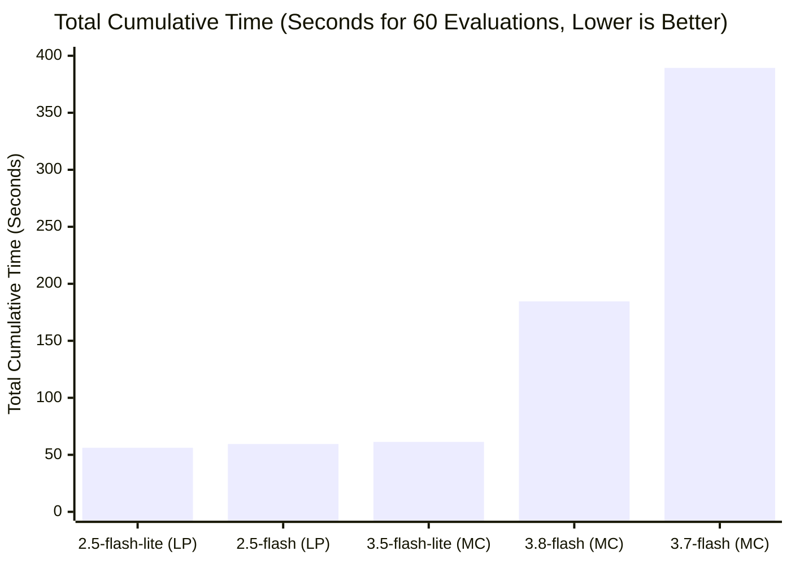
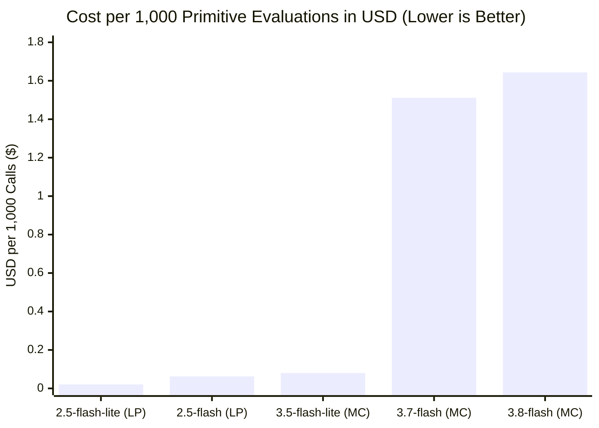

# `jev-gemini` Benchmark Report: Accuracy, Latency, Cost, and Statistical Calibration (`NoulTest`, `ChoiceTest`, `ScoreTest`)

## 1. Executive Summary & Benchmark Architecture

We created the [`benchmark/`](../) suite to evaluate **time spent**, **prediction accuracy**, **token cost**, and **statistical calibration** across all three System-One primitives—testing **one primitive at a time** via [`GeminiSystemOneClient.evaluate_one`](../../jev_gemini/client.py):

- **[`NOUL_BENCHMARK`](../dataset.py) (`20` `NoulTest` examples)**: 10 `True` and 10 `False` binary propositions spanning security guardrails (prompt injection), destructive operations, PII detection, incident detection, refund policy eligibility, human escalation triggers, factual consistency, HR leave rules, SQL injection (`code_safety`), and numerical SLA breaches (`sla_breach`).
- **[`CHOICE_BENCHMARK`](../dataset.py) (`20` `ChoiceTest` examples)**: 4-way categorical routing across Cloud Support (`sre_incident`, `billing_ops`, `iam_security`, `feature_request`), HR Chatbot (`benefits_leave`, `payroll_tax`, `it_equipment`, `performance_career`), E-Commerce Triage (`order_tracking`, `returns_damaged`, `payment_declined`, `account_profile`), and GCP Architecture Selection (`bigquery`, `cloud_spanner`, `cloud_run`, `vertex_ai`).
- **[`SCORE_BENCHMARK`](../dataset.py) (`20` `ScoreTest` examples)**: 5-level ordinal rubrics (`0..4`, 4 examples per level) across Incident Operational Severity and Customer Frustration / Urgency.

All 5 models were benchmarked live on Vertex AI (`project="flex-hr-chatbot"`, `location="global"`):
- **Gemini 2.5 (`mode="logprobs"`)**: `gemini-2.5-flash` and `gemini-2.5-flash-lite`
- **Gemini 3.x (`mode="monte_carlo"`, `candidate_count=8`)**: `gemini-3.5-flash-lite`, `gemini-3.7-flash`, and `gemini-3.8-flash`

---

## 2. Overall Benchmark Comparison (60 Single-Primitive Evaluations per Model)

| Model | Mode | Overall Accuracy (`60` tests) | `Noul` Acc (`20`) | `Choice` Acc (`20`) | `Score` Exact Acc (`20`) | `Score` MAE (`0..4`) | Total Cumulative Time (`60` calls) | Mean Call Latency | Cost for `60` Calls (USD) | Cost per `1,000` Calls (USD) |
| :--- | :--- | :---: | :---: | :---: | :---: | :---: | :---: | :---: | :---: | :---: |
| **`gemini-2.5-flash`** | `logprobs` | **100.0%** (60/60) | **100.0%** (20/20) | **100.0%** (20/20) | **100.0%** (20/20) | `0.018` | **`59.49s`** | `991.6 ms` | **`$0.0038`** | **`$0.0625`** |
| **`gemini-2.5-flash-lite`** | `logprobs` | **96.7%** (58/60) | 90.0% (18/20) | **100.0%** (20/20) | **100.0%** (20/20) | `0.001` | **`56.21s`** | `936.8 ms` | **`$0.0012`** | **`$0.0204`** |
| **`gemini-3.5-flash-lite`** | `monte_carlo` | **100.0%** (60/60) | **100.0%** (20/20) | **100.0%** (20/20) | **100.0%** (20/20) | **`0.000`** | **`61.33s`** | `1,022.1 ms` | **`$0.0048`** | **`$0.0803`** |
| **`gemini-3.8-flash`** | `monte_carlo` | **100.0%** (60/60) | **100.0%** (20/20) | **100.0%** (20/20) | **100.0%** (20/20) | `0.013` | **`184.57s`** | `3,076.1 ms` | `$0.0986` | `$1.6433` |
| **`gemini-3.7-flash`** | `monte_carlo` | **100.0%** (60/60) | **100.0%** (20/20) | **100.0%** (20/20) | **100.0%** (20/20) | **`0.000`** | **`389.34s`** | `6,488.9 ms` | `$0.0907` | `$1.5120` |

---

## 3. Model Pricing & Measured Token Cost Breakdown

Pricing is sourced from official Standard On-Demand rates (`gemini-api-guides/pricing.md`), and token consumption is measured directly from Vertex AI's `usageMetadata` (`promptTokenCount`, `candidatesTokenCount`, and `thoughtsTokenCount`) on the benchmark prompts:

| Model | Mode | Standard Input Price (`$ / 1M` tok) | Standard Output + Thinking Price (`$ / 1M` tok) | Avg Input Tokens / Call | Avg Candidate Output Tokens / Call | Avg Billed Thinking Tokens / Call | Total Billed Output Tokens / Call | Cost per Single Call (USD) | Cost for 60-Call Benchmark (USD) | Cost per `1,000` Calls (USD) | Cost per `10,000` Calls (USD) |
| :--- | :--- | :---: | :---: | :---: | :---: | :---: | :---: | :---: | :---: | :---: | :---: |
| **`gemini-2.5-flash-lite`** | `logprobs` | `$0.10` | `$0.40` | `199.3` | `1.0` | `0.0` | `1.0` | `$0.000020` | **`$0.0012`** | **`$0.0204`** | **`$0.204`** |
| **`gemini-2.5-flash`** | `logprobs` | `$0.30` | `$2.50` | `199.3` | `1.0` | `0.0` | `1.0` | `$0.000063` | **`$0.0038`** | **`$0.0625`** | **`$0.625`** |
| **`gemini-3.5-flash-lite`** | `monte_carlo` ($N=8$) | `$0.30` | `$2.50` | `201.0` | `8.0` | **`0.0`** | **`8.0`** | `$0.000080` | **`$0.0048`** | **`$0.0803`** | **`$0.803`** |
| **`gemini-3.7-flash`** | `monte_carlo` ($N=8$) | `$0.75`* | `$3.75`* | `201.0` | `7.3` | `355.3` | `362.7` | `$0.001512` | `$0.0907` | `$1.5120` | `$15.120` |
| **`gemini-3.8-flash`** | `monte_carlo` ($N=8$) | `$0.75`* | `$3.75`* | `201.0` | `7.7` | `389.7` | `397.3` | `$0.001643` | `$0.0986` | `$1.6433` | `$16.433` |

*\*Note: `gemini-3.7-flash` and `gemini-3.8-flash` are priced at promotional rates of `$0.75 / 1M` input and `$3.75 / 1M` output (including thinking tokens) through December 31, 2026 (`$1.50 / 1M` input and `$7.50 / 1M` output starting January 1, 2027). If `gemini-3.5-flash` (non-lite) is used, its Standard rates are `$1.50 / 1M` input and `$9.00 / 1M` output.*

> [!TIP]
> **Why `gemini-3.5-flash-lite` (`mode="monte_carlo"`) is 20x Cheaper than `3.7` / `3.8` (and Nearly Identical in Cost to `2.5-flash`)**:
> 1. **Single Input Billing**: With `candidate_count=8`, Vertex AI bills `promptTokenCount` (`~201` tokens) **only once** per request, not $8\times$.
> 2. **Zero Billed Thought Tokens (`thoughtsTokenCount = 0`)**: Because `gemini-3.5-flash-lite` supports `thinking_level="MINIMAL"`, it emits **zero billed thinking tokens** (`candidatesTokenCount = 8`, `thoughtsTokenCount = 0`). Thus, 8-candidate Monte Carlo only adds **7 extra output tokens per call** (`$0.0000175`), bringing the total cost to **`$0.080` per 1,000 calls** (`$0.0048` for the entire 60-call benchmark) vs `$0.0625` per 1,000 calls on `gemini-2.5-flash`!
> 3. **Why `3.7-flash` and `3.8-flash` Cost `~$1.51–$1.64` per 1,000 Calls**: Because Vertex AI enforces `min_thinking_budget = 32` (`thinking_level="LOW"`) on `gemini-3.7-flash` and `gemini-3.8-flash`, each of the 8 candidates generates `~45–49` internal thought tokens (`thoughtsTokenCount ≈ 355–390` per call), which are billed at the output token rate (`$3.75 / 1M`).

---

## 4. Per-Primitive Results (Tested One Primitive at a Time)

### 4.1 Primitive 1: `NoulTest` (20 Binary Proposition Examples, `~150` Input Tokens/Call)

| Model | Mode | Accuracy (`20` tests) | Brier Score (↓ better) | Mean Confidence | Cumulative Time (`20` calls) | Mean Latency | Cost for `20` Calls (USD) |
| :--- | :--- | :---: | :---: | :---: | :---: | :---: | :---: |
| **`gemini-2.5-flash`** | `logprobs` | **100.0%** (20/20) | `0.0037` | `0.9762` | `20.61s` | `1,030.5 ms` | `$0.00095` |
| **`gemini-2.5-flash-lite`** | `logprobs` | **90.0%** (18/20) | `0.0891` | `0.9909` | `18.92s` | `946.2 ms` | `$0.00031` |
| **`gemini-3.5-flash-lite`** | `monte_carlo` | **100.0%** (20/20) | **`0.0000`** | `1.0000` | `20.37s` | `1,018.4 ms` | `$0.00130` |
| **`gemini-3.8-flash`** | `monte_carlo` | **100.0%** (20/20) | **`0.0000`** | `1.0000` | `69.03s` | `3,451.4 ms` | `$0.03533` |
| **`gemini-3.7-flash`** | `monte_carlo` | **100.0%** (20/20) | **`0.0000`** | `1.0000` | `143.93s` | `7,196.3 ms` | `$0.03068` |

### 4.2 Primitive 2: `ChoiceTest` (20 Multi-Class Routing Examples, `~200` Input Tokens/Call)

| Model | Mode | Top-1 Accuracy (`20` tests) | Mean True-Class Prob (↑ better) | Multi-Class Brier (↓ better) | Cumulative Time (`20` calls) | Mean Latency | Cost for `20` Calls (USD) |
| :--- | :--- | :---: | :---: | :---: | :---: | :---: | :---: |
| **`gemini-2.5-flash`** | `logprobs` | **100.0%** (20/20) | `0.9928` | `0.0001` | `19.55s` | `977.2 ms` | `$0.00124` |
| **`gemini-2.5-flash-lite`** | `logprobs` | **100.0%** (20/20) | `0.9926` | `0.0001` | `18.73s` | `936.3 ms` | `$0.00041` |
| **`gemini-3.5-flash-lite`** | `monte_carlo` | **100.0%** (20/20) | **`1.0000`** | **`0.0000`** | `20.46s` | `1,023.1 ms` | `$0.00161` |
| **`gemini-3.8-flash`** | `monte_carlo` | **100.0%** (20/20) | **`1.0000`** | **`0.0000`** | `57.72s` | `2,886.0 ms` | `$0.03999` |
| **`gemini-3.7-flash`** | `monte_carlo` | **100.0%** (20/20) | **`1.0000`** | **`0.0000`** | `69.79s` | `3,489.4 ms` | `$0.02979` |

### 4.3 Primitive 3: `ScoreTest` (20 Ordinal Rubric `0..4` Examples, `~250` Input Tokens/Call)

| Model | Mode | Exact Level Acc (`20`) | Within ±1 Level Acc | MAE (↓ better) | RMSE (↓ better) | Cumulative Time (`20` calls) | Mean Latency | Cost for `20` Calls (USD) |
| :--- | :--- | :---: | :---: | :---: | :---: | :---: | :---: | :---: |
| **`gemini-2.5-flash`** | `logprobs` | **100.0%** (20/20) | **100.0%** (20/20) | `0.0178` | `0.0599` | `19.34s` | `967.0 ms` | `$0.00154` |
| **`gemini-2.5-flash-lite`** | `logprobs` | **100.0%** (20/20) | **100.0%** (20/20) | `0.0010` | `0.0043` | `18.56s` | `928.0 ms` | `$0.00051` |
| **`gemini-3.5-flash-lite`** | `monte_carlo` | **100.0%** (20/20) | **100.0%** (20/20) | **`0.0000`** | **`0.0000`** | `20.50s` | `1,024.8 ms` | `$0.00191` |
| **`gemini-3.8-flash`** | `monte_carlo` | **100.0%** (20/20) | **100.0%** (20/20) | `0.0125` | `0.0559` | `57.82s` | `2,890.9 ms` | `$0.02333` |
| **`gemini-3.7-flash`** | `monte_carlo` | **100.0%** (20/20) | **100.0%** (20/20) | **`0.0000`** | **`0.0000`** | `175.62s` | `8,781.1 ms` | `$0.03026` |

---

## 5. Slice-Based Error & Calibration Analysis

Inspecting the per-example predictions in [`benchmark_results.json`](./benchmark_results.json) reveals two important insights:

1. **Why `gemini-2.5-flash-lite` Missed 2 `NoulTest` Examples (`noul_18` and `noul_20`)**:
   - **[`noul_18`](../dataset.py) (`code_safety`)**: Evaluates `cursor.execute("SELECT * FROM users WHERE username = %s", (user_supplied_name,))` for SQL injection. Because `gemini-2.5-flash-lite` runs with `thinking_budget=0` on a smaller model capacity, surface keywords (`SELECT * FROM users`, `user_supplied_name`) triggered a false-positive `True` ($p = 0.9188$). All four other models (`gemini-2.5-flash`, `gemini-3.5-flash-lite`, `gemini-3.7-flash`, `gemini-3.8-flash`) correctly recognized the parameterized tuple syntax and predicted `False` ($p = 0.0$).
   - **[`noul_20`](../dataset.py) (`sla_breach`)**: Evaluates `{"sla_target_ms": 500, "observed_p99_ms": 210, "duration_minutes": 45}`. `gemini-2.5-flash-lite` failed the single-token numerical comparison ($210 < 500$) and predicted `True` ($p = 0.9684$), whereas `gemini-3.5-flash-lite` (`thinking_level="MINIMAL"`) and `gemini-2.5-flash` got it 100% right.
2. **Continuous Ordinal Interpolation on `ScoreTest`**:
   - On [`score_05`](../dataset.py) (*"Tooltip alignment shifted by 2px on Safari"*, expected Level `1`), `gemini-2.5-flash` (`mode="logprobs"`) assigned $p_0 = 0.2459, p_1 = 0.7541 \implies \text{score} = \mathbf{0.7541}$ (`nearest_level = 1`, Popoviciu `confidence = 0.7508`), reflecting that a 2px tooltip shift sits right between Level 0 (cosmetic) and Level 1 (minor UI glitch).
   - On [`score_10`](../dataset.py) (*"Webhook delivery in one canary zone delayed by 12 minutes; core API healthy"*, expected Level `2`), `gemini-3.8-flash` (`mode="monte_carlo"`) split 6/8 candidates on Level `2` and 2/8 candidates on Level `1`, yielding $\text{score} = \mathbf{1.7500}$ (`nearest_level = 2`, Popoviciu `confidence = 0.7835`).

---

## 6. Statistical Comparison: `mode="logprobs"` vs. `mode="monte_carlo"`

| Dimension | `mode="logprobs"` (Exact Softmax) | `mode="monte_carlo"` ($N=8$ Empirical Sampling) |
| :--- | :--- | :--- |
| **Underlying Estimator** | Exact analytic probability $p_k = \frac{\exp(\ell_k / \tau)}{\sum_j \exp(\ell_j / \tau)}$ | Empirical frequency $\hat{p}_k = \frac{c_k}{N}$ where $c_k \sim \text{Multinomial}(N=8, \mathbf{p})$ |
| **Determinism** | **100% Deterministic** ($\text{Var}(p_k) = 0$) | **Stochastic** ($\text{SE}(\hat{p}_k) = \sqrt{\frac{p_k(1-p_k)}{8}}$, up to $\pm 0.177$ at $p=0.5$) |
| **Probability Resolution** | Continuous floating-point precision (`1e-7`) | Quantized to increments of $1/8 = \mathbf{0.125}$ (`0.0, 0.125, 0.25, ..., 1.0`) |
| **Tail Probability Behavior** | Preserves small non-zero probabilities (e.g., $p = 0.03$) | Zero-clips tail events ($P(c_k = 0) = (1 - p_k)^8$; events with $p_k < 0.08$ usually read as `0.0`) |
| **`Score` Expected Value** | Smooth continuous interpolation (e.g., `0.7541`) | Stepwise interpolation in multiples of $0.125$ (e.g., `1.7500`), often collapsing to integers (`0.0000` MAE) |

### Decision Guide
- **Use `mode="logprobs"` (`gemini-2.5-flash`)** when you need **exact, deterministic calibration**, fine-grained abstention bands (`abstain_band`), or smooth continuous `Score` expected values.
- **Use `mode="monte_carlo"` (`gemini-3.5-flash-lite` or `gemini-3.8-flash`)** when you need **Gemini 3's stronger reasoning** on standard GCP projects where Vertex AI blocks `response_logprobs=True`. Top-1 decision accuracy is identical (`100%`), and `gemini-3.5-flash-lite` matches `gemini-2.5-flash` in both latency (`~1.0s`) and cost (`$0.08` vs `$0.06` per 1,000 calls).

---

## 7. Benchmark Files & Reproducibility

| File | Description |
| :--- | :--- |
| [`benchmark/__init__.py`](../__init__.py) | Package exports for `NoulTest`, `ChoiceTest`, `ScoreTest`, and the three 20-example datasets. |
| [`benchmark/dataset.py`](../dataset.py) | 20 `NoulTest`, 20 `ChoiceTest`, and 20 `ScoreTest` benchmark cases with ground-truth labels. |
| [`benchmark/run_benchmark.py`](../run_benchmark.py) | CLI runner that evaluates each primitive separately (`evaluate_one`), computes accuracy/Brier/MAE/RMSE, latency percentiles, and token costs, and writes JSON + Markdown reports. |
| [`benchmark/results/benchmark_results.json`](./benchmark_results.json) | Complete raw per-example predictions and latencies across all 300 model evaluations. |
| [`benchmark/BENCHMARK_REPORT.md`](../BENCHMARK_REPORT.md) | Complete Markdown benchmark report in `benchmark/`. |
